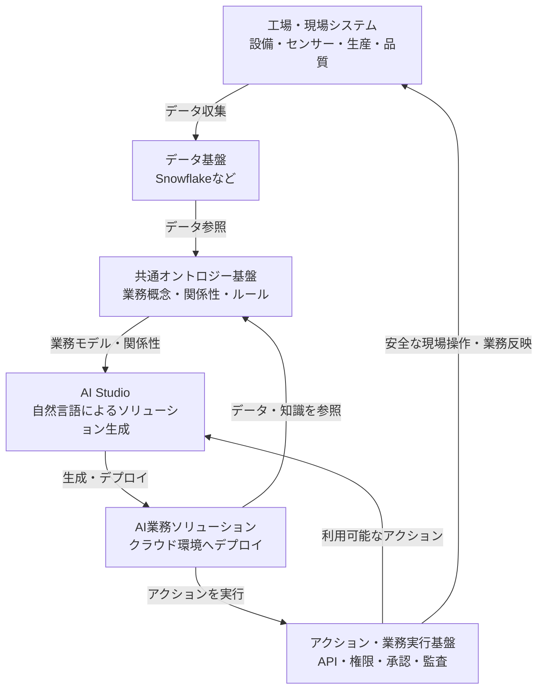

# SnowflakeとPalantirのオントロジーの違いと、製造業向けAI基盤への活用

## 1. エグゼクティブサマリー

**Snowflakeでデータを統合できるなら、なぜPalantirのようなオントロジーが必要なのか？**

結論は、**「データが統合されていること」と「データが表す業務上の意味や関係性を理解し、実際の業務を実行できること」は異なるため**である。

Snowflakeは、企業内のさまざまなデータを統合・蓄積・分析するためのデータプラットフォームである。

一方、Palantir Foundryのオントロジーは、データを現実世界の業務オブジェクトとしてモデル化し、その関係性や実行可能なアクションまで統合的に扱うことを重視している。

そのため、両者は必ずしも競合するものではなく、相互補完的に活用できる。

製造業向けAI基盤では、次の4つの役割を組み合わせることが有効と考えられる。

1. **データ基盤**：データの統合・蓄積・分析
2. **オントロジー基盤**：業務概念・関係性・ルールの定義
3. **アクション・業務実行基盤**：業務システムや現場への安全な操作
4. **AI Studio**：自然言語によるAIソリューションの生成・デプロイ

目指すべき姿は、単なるデータ分析基盤ではなく、**データ・業務知識・アクションを共通資産として再利用できるAIソリューション開発基盤**である。

---

## 2. Snowflakeとは何か

Snowflakeは、企業内外のさまざまなデータをクラウド上で統合し、分析・共有・AI活用するためのデータプラットフォームである。

### 2.1 主な機能

| 機能 | 説明 |
|---|---|
| データ統合 | 複数システムのデータを集約 |
| データ保存 | 大量の構造化・半構造化データを保存 |
| データ加工 | SQLなどを利用したデータ変換 |
| データ分析 | 大規模データの集計・分析 |
| データ共有 | 組織内外とのセキュアなデータ共有 |
| AI活用 | Snowflake CortexなどによるAI分析 |
| 意味付け | Semantic Viewsによる業務指標・関係性の定義 |

### 2.2 製造業での活用例

工場には、次のようなデータが存在する。

- 生産管理：生産数量、製造指示、稼働実績
- 設備管理：設備マスタ、故障履歴、保全履歴
- 品質管理：検査結果、不良率、不良原因
- 在庫管理：原材料、仕掛品、完成品
- センサーデータ：温度、圧力、振動、電流

これらのデータをSnowflakeに集約すれば、システムを横断した分析が可能になる。

例えば、設備の温度上昇と不良率の相関関係を調べたり、生産実績と故障履歴を組み合わせて設備停止による損失を分析したりできる。

### 2.3 Snowflakeの特徴

Snowflakeは、ストレージとコンピュートを分離したアーキテクチャを採用している。

- ストレージ：データの保存
- コンピュート：SQLや各種データ処理の実行
- クラウドサービス：認証、権限、メタデータ、処理管理

これにより、同じデータを使いながら、部署や用途ごとに独立した計算リソースを利用できる。

---

## 3. Snowflakeだけでは解決しにくい課題

Snowflakeはデータ統合・分析に強みを持つが、データを統合するだけでは、業務上の意味や関係性がすべて明らかになるわけではない。

### 3.1 工場データの具体例

**設備マスタ**

| 設備ID | 設備名 | ライン |
|---|---|---|
| M001 | プレス機A | L01 |
| M002 | プレス機B | L01 |

**センサーデータ**

| 設備ID | 温度 | 振動 |
|---|---|---|
| M001 | 95℃ | 8.2 |
| M002 | 62℃ | 2.1 |

**生産実績**

| ライン | 製品 | 生産数 |
|---|---|---|
| L01 | 製品X | 500 |
| L01 | 製品Y | 300 |

これらのデータが統合されていれば、SQLによって「温度が90℃を超える設備」や「ライン別の生産数量」を調べられる。

しかし、次の質問は単純なSQLだけでは解決しにくい。

> プレス機Aが故障した場合、どの製品に影響するのか？代替できる設備は存在するか？代替設備への切り替えを実行できるか？

この質問に回答するためには、以下の知識が必要となる。

1. プレス機Aがどの製造ラインに所属するか
2. 製造ラインがどの製品を製造するか
3. 各製品がどの設備や工程に依存しているか
4. 代替可能な設備は何か
5. 代替設備の利用条件は何か
6. 設備切り替えの権限や安全条件は何か
7. 設備切り替えを実行するAPIや業務手順は何か

これらを各アプリケーションで個別に実装すると、開発の重複や業務ロジックの不整合が発生しやすくなる。

---

## 4. オントロジーとは何か

オントロジーとは、対象となる世界の概念、属性、関係性などを明示的に定義したモデルである。

製造業では、設備・製造ライン・工程・製品・作業指示などを業務上の概念として定義する。

### 4.1 オントロジーによる関係性の表現

例えば、次のような関係性を定義する。

```text
プレス機A
  ├─ 所属する → 製造ライン01
  ├─ 実行する → プレス工程
  ├─ 製造に関与する → 製品X
  ├─ 代替候補 → プレス機B
  └─ 保全対象 → 保全依頼001
```

こうした関係性を定義することで、システムは単にデータを検索するだけでなく、業務オブジェクト間のつながりをたどれるようになる。

### 4.2 オントロジーによる効果

**① 業務概念の統一**

各システムで異なる名称や形式を持つデータを、共通の業務概念として扱える。

**② 関係性の明示**

設備とライン、設備と製品、製品と工程などの関係性を表現できる。

**③ 業務知識の再利用**

共通の業務モデルを複数のアプリケーションやAIエージェントから利用できる。

**④ AIによる業務理解の支援**

AIが業務上の概念や関係性を参照できるため、複雑な業務課題の分析や判断を支援しやすくなる。

ただし、オントロジーを定義するだけでAIが自動的に正しい判断を行うわけではない。正確なデータ、適切なルール、推論・検索処理が必要となる。

---

## 5. SnowflakeとPalantirの違い

### 5.1 機能比較

| 比較項目 | Snowflake | Palantir Foundry |
|---|---|---|
| 主な強み | データ統合・分析・AI活用 | データと業務オブジェクト・操作の統合 |
| データ統合 | 強い | 対応 |
| SQL分析 | 強い | 対応 |
| データの意味付け | Semantic Views等 | オントロジー |
| 関係性の表現 | リレーション・セマンティックモデル等 | オブジェクトとリンク |
| 業務アクション | API連携・アプリ開発等で実現 | Actions・Functionsと統合 |
| AI連携 | Cortex AI等 | AIP等 |
| 業務システム連携 | 別途連携設計が必要 | オントロジーを中心とした連携を重視 |

### 5.2 本質的な違い

Snowflakeは、データを統合し、分析・AI活用するための機能を幅広く提供する。

Palantir Foundryは、データを業務上のオブジェクトや関係性として扱い、アプリケーションや業務アクションに結び付けることを重視する。

ただし、SnowflakeにもセマンティックモデルやAIアプリケーション開発機能があり、Palantirにも強力なデータ統合・分析機能がある。

そのため、両者は機能が完全に分離された製品ではなく、設計思想と強みが異なる製品として理解すべきである。

---

## 6. AIエージェントにおけるオントロジーの重要性

AIエージェントが単純なデータ分析を行うだけであれば、データウェアハウスとAI機能の組み合わせで十分な場合がある。

しかし、複数の業務システムを横断し、実際の業務操作まで行う場合には、共通の業務モデルが有用になる。

### 6.1 AIエージェントへの指示例

> 故障リスクの高い設備を特定し、生産への影響を分析してください。代替可能な設備があれば対応策を提案し、安全条件を満たす場合に必要な業務処理を実行してください。

この指示に対応するには、次の処理が必要となる。

1. **データ取得**：設備状態・故障履歴・生産実績を取得
2. **異常分析**：故障リスクを推定
3. **関係性探索**：影響を受ける工程・製品・製造ラインを特定
4. **代替案検討**：代替設備の能力・空き状況・制約を確認
5. **実行条件確認**：権限・安全条件・承認要否を確認
6. **業務実行**：業務APIを利用して保全依頼などを発行
7. **結果確認**：操作結果を検証し、監査ログに記録

オントロジーは、特に3〜5の業務知識やルールを共通化するうえで有効である。

一方、6〜7の実行処理については、アクション基盤や業務APIとの統合が必要となる。

---

## 7. オントロジーは必須なのか

すべてのデータ活用にオントロジーが必要なわけではない。

| ユースケース | オントロジーの必要性 |
|---|---|
| 生産数量の可視化 | 低い |
| 不良率の分析 | 低い |
| SQLによるデータ集計 | 低い |
| 自然言語による分析 | 必須ではない |
| 設備・工程・製品の依存関係の把握 | 高まる |
| 複数AIによる業務知識の共有 | 高まる |
| 複雑な業務判断の自動化 | 高まる |
| AIによる業務アクションの実行 | 業務モデルとアクションの共通化が有効 |

オントロジーを採用する価値が高くなるのは、次のような条件がある場合である。

- 複数のシステムに業務知識が分散している
- データ間の関係性が複雑である
- 複数のアプリケーションで同じ業務知識を利用する
- AIエージェントが業務プロセスを横断する
- 業務アクションの実行条件や権限を共通管理したい

なお、共通の業務モデルを実現するために、必ずしもRDFやOWL、グラフDBが必要というわけではない。

データの性質や要件によっては、リレーショナルDB、API、ルールエンジンなどでも実現可能である。

---

## 8. 製造業向けAI基盤の推奨アーキテクチャ

Snowflake等の既存データ基盤を活用しながら、オントロジーとアクションを独立した共通基盤として整備する構成が考えられる。

### 8.1 全体構成



※概念図。実際の構成では、データ取得経路、制御系と情報系の分離、API認証、ネットワーク、権限管理などの詳細設計が必要となる。

### 8.2 各基盤の役割

#### ① データ基盤

Snowflake等を利用し、以下を実現する。

- 工場データの統合
- 履歴データの蓄積
- データ加工・分析
- AI向けデータ提供

#### ② 共通オントロジー基盤

設備・工程・製品などの業務概念と関係性を定義する。

- オブジェクトの定義
- オブジェクト間の関係性
- 業務ルール・制約
- データ取得先やAPI識別子との対応
- AI・アプリケーションからの共通利用

#### ③ アクション・業務実行基盤

業務システムや現場システムへの操作を共通化する。

- 業務APIの提供
- アクションの定義・管理
- 認証・認可
- 承認ワークフロー
- 安全条件の検証
- 実行結果の確認
- 監査ログ

AIによる自律的な操作も将来的には可能だが、設備操作に関しては現場側の安全制御を独立して維持することが重要となる。

#### ④ AI Studio

共通オントロジーとアクションを利用し、自然言語からAIソリューションを生成する開発環境を目指す。

想定する機能は次のとおり。

- 自然言語による業務要件の入力
- 関連する業務オブジェクトの探索
- データ取得・分析ロジックの生成
- 利用可能なアクションの選択
- AIエージェント・業務画面の生成
- テスト・セキュリティ検証
- 適切なクラウド環境へのデプロイ

これらは目標とする将来機能であり、自然言語だけで安全かつ正確なソリューションが自動生成されることを保証するものではない。

---

## 9. 想定されるAIソリューション

共通オントロジーとアクション基盤を整備することで、次のようなソリューションを効率的に開発できる可能性がある。

### 9.1 設備故障予測AI

設備の状態や履歴から故障リスクを検出し、影響する生産ラインや製品を特定する。

さらに、条件を満たす場合には保全依頼の作成などを実行する。

### 9.2 品質異常原因分析AI

品質異常が発生した際、製品・設備・工程・原材料・生産ロットの関係性を探索し、原因候補を提示する。

### 9.3 生産計画最適化AI

設備能力、稼働状況、製造条件、納期、在庫情報を横断的に参照し、生産計画の最適化案を生成する。

### 9.4 自律型工場運用AI

将来的には、異常検出から原因分析、対応策の選択、承認・安全確認、業務実行、結果検証までを連続的に処理する構成が考えられる。

ただし、実設備の操作については、リスクに応じた承認・制御範囲の制限・インターロック・フェイルセーフなどが必要となる。

---

## 10. 独自オントロジー基盤を構築する意義

独自基盤を開発する最大の意義は、単にグラフデータベースやオントロジーを導入することではない。

**共通の業務知識とアクションを、複数のAIソリューションから再利用できる仕組みを構築すること**にある。

例えば、次の3つのAIを開発するとする。

1. 設備故障予測AI
2. 品質異常分析AI
3. 生産計画最適化AI

共通基盤が存在しない場合、それぞれのAIで設備マスタ、製品情報、工程情報、業務APIなどの連携を個別に設計する必要がある。

一方、オントロジーとアクションを共通化すれば、同じ業務オブジェクトや操作を複数のソリューションで利用できる。

### 期待される効果

| 観点 | 期待される価値 |
|---|---|
| 開発生産性 | 共通業務モデル・APIの再利用 |
| データ活用 | 異なるシステムの意味的な統合 |
| AI品質 | 業務知識に基づく判断支援 |
| 拡張性 | 新たなAIソリューションの追加 |
| ガバナンス | 共通の権限・操作ルールの適用 |
| 保守性 | 業務定義の一元管理 |
| 自動化 | 安全条件に基づく業務実行の高度化 |

これらの効果は、業務モデルの品質や運用設計、利用するアプリケーションの構成によって左右される。

---

## 11. 結論

Snowflakeとオントロジーは、解決する課題の重点が異なる。

- **Snowflake**：データを統合・蓄積・分析し、AIで活用できるようにする
- **オントロジー**：業務概念や関係性を共通化し、複雑な業務理解を支援する
- **アクション基盤**：業務システムや現場システムに安全な操作を提供する
- **AI Studio**：これらの共通機能を利用してAIソリューションを効率的に生成・展開する

したがって、目指すべき方向性はSnowflakeの代替ではなく、Snowflakeを含む既存データ基盤の上に、業務の意味と実行機能を提供する共通レイヤーを構築することである。

### 最終的なコンセプト

**「データを統合する基盤」から「業務を理解し、AIが安全に行動できる基盤」へ。**

データ基盤・オントロジー・アクション・AI Studioを組み合わせ、企業内に蓄積されたデータと業務知識を再利用可能な資産として活用する。

これにより、個別のAIアプリケーションを都度開発する方式から、共通の業務モデルを基盤として、多様なAIソリューションを継続的に創出できる仕組みへの発展を目指す。